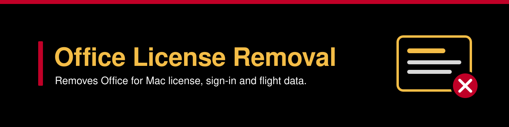
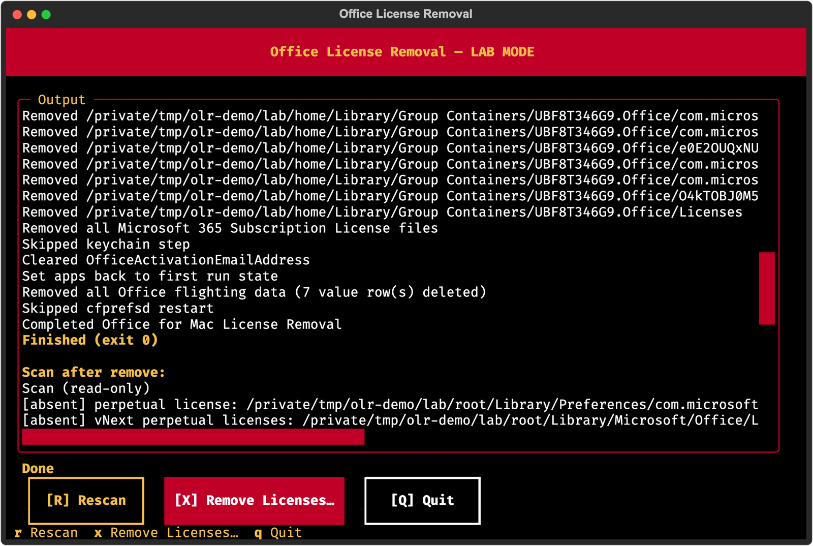
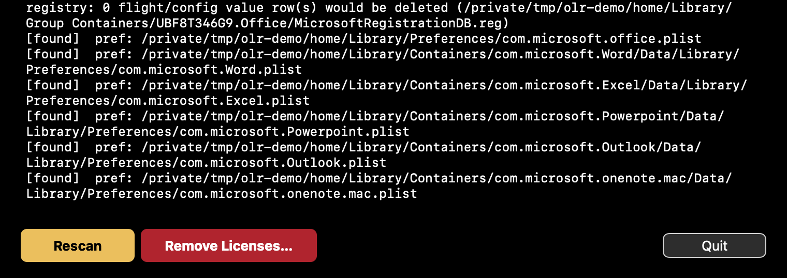

<p align="center"></p>

<p align="center">
  
  
  
</p>

Office License Removal is a Rust replacement for the postinstall script in Microsoft's "Office for Mac License Removal Tool 2.7". It fixes two faults in that script: the flight reset never ran, and the keychain deletes did not remove the user's sign-in items. You can use it as a native app, as a terminal UI or from the command line.

<p align="center"></p>

**Contents**

- [Quick start](#quick-start)
- [What it fixes](#what-it-fixes)
- [Three ways to run it](#three-ways-to-run-it): [app](#app), [terminal UI](#terminal-ui), [command line](#command-line)
- [What `remove` changes](#what-remove-changes)
- [Safety](#safety) and [lab mode](#lab-mode)
- [Build and test](#build-and-test)
- [Signing and quarantine](#signing-and-quarantine)
- [What the automated tests do not cover](#what-the-automated-tests-do-not-cover)
- [Changelog](CHANGELOG.md)

## Quick start

| Requirement | Needed for |
| --- | --- |
| macOS 14 or later | The app |
| Rust with the `aarch64-apple-darwin` and `x86_64-apple-darwin` targets | `scripts/build-app.sh` |
| Python 3.10 or later (the launcher installs Textual) | The terminal UI |

1. Build the app and the command-line tool. The script writes both to `dist/`.

   ```sh
   scripts/build-app.sh
   ```

2. Scan the Mac. A scan changes nothing.

   ```sh
   dist/office-license-removal scan
   ```

3. Read [Safety](#safety). A remove cannot be undone.

4. Remove the licenses. In the app, click the **Remove Licenses…** button. On the command line, run `remove` as root:

   ```sh
   sudo dist/office-license-removal remove
   ```

## What it fixes

Two faults in Microsoft's 2.7 script make parts of it fail without an error.

| Fault in the 2.7 script | Result | What this tool does |
| --- | --- | --- |
| The script is zsh, and zsh rejects `[ x == y ]`. | Every registry lookup returned an empty string. Every SQL statement failed. The flight reset never ran. | It deletes the flight rows with parameterised SQL in one immediate transaction. |
| The keychain deletes ran in the securityd session of root. The login keychain of the user stays locked in that session. | The sign-in items remained in the keychain. | It runs the keychain and `defaults` commands in the session of the user (`launchctl asuser … sudo -u`). The login keychain stays unlocked in that session. |

All other steps follow the corrected script in [`reference/postinstall-2.7.1-local`](reference/postinstall-2.7.1-local) step for step. The tool uses the same paths, the same keychain items and the same registry values.

## Three ways to run it

Three front ends share one command-line tool (CLI).

| Front end | File | Source |
| --- | --- | --- |
| Native app (Rust and AppKit) | `dist/Office License Removal.app` | Crate `app/` |
| Terminal UI (Python and Textual) | `dist/Office License Removal.command` | The launcher file |
| Command-line tool | `dist/office-license-removal` | Root crate |

### App

`dist/Office License Removal.app` is a native macOS window around the CLI. The build script puts the CLI next to the app executable in `Contents/MacOS/`.

<p align="center"><br><sub>App window in lab mode, lower part. The scan finds 7 flight rows.</sub></p>

<p align="center"><br><sub>The same window after the remove. The new scan finds 0 flight rows.</sub></p>

- The window is always dark. It has a crimson header band with a gold title and the status line. The output is white on black.
- The `Rescan` button is gold. The `Remove Licenses…` button is crimson.
- At launch, and after every remove, the app runs `scan --user <you>` and shows the output.
- While a scan or a remove runs, Quit and the window close button do nothing. The status line shows `Wait for the current run to finish.` for 3 s.

When you click `Remove Licenses…`, the app asks for confirmation. Type `REMOVE` and press **Remove**. Then this sequence starts:

1. The app calculates the SHA-256 hash of the bundled CLI.
2. The app runs the remove through `osascript … with administrator privileges`. macOS asks for an admin password.
3. As root, the shell copies the CLI into a new root-only folder `/private/tmp/olr.XXXXXX`.
4. The shell compares the SHA-256 hash of the copy with the confirmed hash.
5. If the hashes are the same, the shell runs the copy with `remove --yes --user <you>`.

If the hashes are different, the log shows `REFUSED: office-license-removal changed since confirmation`. The status shows `Failed (exit 3)`. If you cancel either prompt, nothing changes. The tool does not remove the `olr.*` folders after the run.

<details>
<summary><b>UI test harness</b></summary>

<br>

`OfficeLicenseRemoval --ui-test <dir> [--flow scan|cancel|remove]` operates the real window without a human. It never activates the app and never orders the window front. It presses the same buttons that a user presses. It renders PNG captures in-process, so it needs no Screen Recording permission.

| Output in `<dir>` | Content |
| --- | --- |
| Numbered PNG files | Captures of the window and the alert |
| `menu.txt` | The menu bar |
| `events.log` | Status changes, captures and `PASS` or `FAIL`, each with the elapsed ms |

| Flow | Steps | Expected result |
| --- | --- | --- |
| `scan` (default) | Waits for the launch scan, captures it and exits 0. This flow also works outside lab mode, because a scan changes nothing. | Status `Scan complete` |
| `cancel` | Opens the Remove alert, types `nope` and presses Remove. | Status `Cancelled; nothing was changed.` and nothing removed |
| `remove` | Types `REMOVE`, presses Remove and waits for the remove and the rescan. | Status `Done` |

The `cancel` and `remove` flows need lab mode (`OLR_LAB_HOME` and `OLR_LAB_SYSTEM_ROOT`). Without lab mode, they write `refused: …` and exit 3.

| Exit code | Meaning |
| --- | --- |
| 0 | Pass |
| 2 | Fail, or timeout after 120 s |
| 3 | Refused |
| 64 | Bad arguments |

</details>

### Terminal UI

`dist/Office License Removal.command` is a terminal UI that opens with a double-click. It uses Textual 8 and runs Python with `-I`. The CLI must be in the same folder.

The launcher looks for a Python environment in this order:

1. The private environment in `~/Library/Application Support/office-license-removal/venv`.
2. `~/.venv`, if it has Python 3.10 or later and Textual 8.
3. If neither works, the launcher installs Textual 8.2.8 into the private environment. It creates the environment from the first Python 3.10 or later that it finds. This step needs an internet connection.

The launcher never changes the system Python. To install the dependencies without opening the UI, run the launcher with `--setup-deps`.

- If `/Applications/kitty.app` exists, the UI opens in a 100×44 kitty window. If not, it resizes the current terminal.
- The UI runs `scan --user <you>` at launch and after every remove.
- The keys are `r` (rescan), `x` (remove) and `q` (quit).

To remove the licenses from the terminal UI:

1. Press `[X] Remove Licenses…` to open the confirm dialog.
2. Type `REMOVE` in the field. The text must be exactly `REMOVE`.
3. Press **Remove**. The UI suspends and runs the remove under `sudo` in the terminal.
4. Enter your password. Root copies the CLI into a new root-only folder `/private/tmp/olr.XXXXXX`.
5. Root checks that the copy has the SHA-256 hash from your confirmation. Then root runs the copy.

If the CLI changed between the confirmation and the run, the UI prints `REFUSED: office-license-removal changed since confirmation`. It then exits 3 and changes nothing. Press Ctrl-C at the password prompt to cancel the run and return to the UI.

### Command line

```
office-license-removal scan   [--user <shortname>] [--home <dir>] [--system-root <dir>]
sudo office-license-removal remove [--user <shortname>] [--yes] [--skip-keychain] [--skip-flights] [--skip-prefs] [--skip-quit]
office-license-removal remove --home <dir> --system-root <dir> [--user <shortname>] [--yes]   # lab mode
```

| Option | Command | Effect |
| --- | --- | --- |
| `--user <shortname>` | `scan`, `remove` | Sets the target user. The default is the console user. |
| `--home <dir>` | `scan`, `remove` | Uses this folder as the home folder of the target user. |
| `--system-root <dir>` | `scan`, `remove` | Adds this prefix to machine-wide paths. The default is `/`. |
| `--yes` | `remove` | Skips the typed `REMOVE` confirmation. |
| `--skip-quit` | `remove` | Skips step 1 (quit the Office apps). |
| `--skip-keychain` | `remove` | Skips step 5 (keychain items). |
| `--skip-prefs` | `remove` | Skips step 6 (preferences). |
| `--skip-flights` | `remove` | Skips step 7 (flight data). |

- `scan` changes nothing. It checks keychain items by their attributes and never reads passwords.
- On `scan`, `--home` and `--system-root` have the same meaning and checks as on `remove`. So you can scan a fixture tree before a lab-mode remove.
- `remove` needs root. Without `--yes`, it prints the scan and continues only when you type `REMOVE`.
- The target user is `--user`, or else the console user. With no console user, only the machine-wide steps run.
- If `--user` names an invalid or unknown user, or a user with no home, `scan` and `remove` stop with exit 1. This occurs before any change.

| Exit code | Meaning |
| --- | --- |
| 0 | Done. |
| 1 | Refused or aborted. This includes a `--user` that the tool cannot resolve. |
| 2 | Finished, but a step failed or the guard refused a path. |

## What `remove` changes

| Step | Change | In lab mode |
| --- | --- | --- |
| 1 | Quits Word, Excel, PowerPoint, Outlook and OneNote for the target user with `pkill -HUP -u <uid>`. It waits up to 5 seconds. It prints `WARNING: <app> still running` for each app that did not exit. | Skipped |
| 2 | Renames `/Library/Preferences/com.microsoft.office.licensingV2.plist` to `com.microsoft.office.licensingV2.Backup`. If that backup exists, it uses `com.microsoft.office.licensingV2.Backup.<YYYYmmdd-HHMMSS>`. | Runs on the fixture |
| 3 | Deletes `/Library/Microsoft/Office/Licenses` (the Office 2021 and 2024 perpetual licenses). | Runs on the fixture |
| 4 | Deletes the six Microsoft 365 subscription files and the `Licenses` folder in `~/Library/Group Containers/UBF8T346G9.Office` of the target user. | Runs on the fixture |
| 5 | Deletes the 15 Office sign-in keychain items in the security session of the user (`launchctl asuser`). Each delete repeats until no item matches, up to 20 times. | Skipped |
| 6 | Clears `OfficeActivationEmailAddress` and sets the first-run flags with `defaults`, run as the user. | Runs on the fixture |
| 7 | Deletes the ECS flight and config-cache values in `MicrosoftRegistrationDB.reg` in one SQLite transaction. | Runs on the fixture |
| 8 | Restarts `cfprefsd`. | Skipped |

Each step writes its result to stdout and to `logger -t OfficeLicenseRemoval`.

## Safety

- **A remove cannot be undone.** Steps 3, 4, 5 and 7 delete files, folders, keychain items and registry rows. The tool keeps no copy of them.
- Step 2 renames the perpetual license file. It does not delete it.
- Scan first. A scan shows what a remove will change, and it changes nothing.
- The tool never reports a path that it cannot inspect (for example, permission denied) as absent. `remove` prints `FAILED to inspect …` and `scan` prints an `[error]` line.
- Keychain checks work the same way. Only exit 44 from `security` means "not found".

### Path guard

Every delete, rename, registry open and `defaults` write passes a path guard. A refused target prints `REFUSED …`. The guard refuses these targets:

- An empty path, `/` or a path with `..`.
- Any path outside the resolved home or system root.
- A target when a folder between the canonical home (or system root) and the target is a symlink.
- A target that is itself a symlink to a path outside.

### Lab mode

Lab mode runs the tool on a fixture tree without root. Use it to test the tool before you use it on a real Mac.

- **CLI:** give both `--home` and `--system-root`. In lab mode, the CLI does not quit apps, does not touch the keychain and does not restart cfprefsd.
- **App and terminal UI:** set both `OLR_LAB_HOME` and `OLR_LAB_SYSTEM_ROOT`. The title then ends in `LAB MODE`.
- In lab mode, the app and the terminal UI give `--home "$OLR_LAB_HOME" --system-root "$OLR_LAB_SYSTEM_ROOT"` to `scan` and `remove`. The CLI runs directly without elevation.
- In lab mode, `scan` still checks the real keychain. It reads item attributes only, never passwords.

`open` does not pass environment variables. To start the app in lab mode, start its executable directly:

```
OLR_LAB_HOME=<fixture>/home OLR_LAB_SYSTEM_ROOT=<fixture>/root "dist/Office License Removal.app/Contents/MacOS/OfficeLicenseRemoval"
```

## Build and test

```
cargo fmt --all --check && cargo clippy --workspace --all-targets -- -D warnings && cargo test --workspace && cargo build --release --workspace
scripts/build-app.sh
```

The tests use fixtures under `$TMPDIR` (`olr-unit-*`, `olr-it-*`). The tests keep these fixtures on disk and never delete them.

<details>
<summary><b>What <code>scripts/build-app.sh</code> does</b></summary>

<br>

1. Builds the CLI and the app for arm64 and x86_64 in release mode.
2. Joins each pair with `lipo`.
3. Writes `Info.plist`.
4. Signs the bundle ad hoc in a staging folder outside the repo and verifies it there. iCloud Drive adds Finder attributes to a bundle in a synced folder, and `codesign` refuses such a bundle.
5. Moves the bundle into `dist/` and copies the same universal CLI to `dist/office-license-removal`.

</details>

<details>
<summary><b>Terminal UI checks</b></summary>

<br>

| Command | What it does | Success line |
| --- | --- | --- |
| `"dist/Office License Removal.command" --self-test` | Checks the dependencies only. It installs nothing. | `SELF-TEST OK` |
| `"dist/Office License Removal.command" --setup-deps` | Installs missing dependencies, then runs the same checks. It does not scan license data. | `SELF-TEST OK` |
| `"dist/Office License Removal.command" --smoke` | Runs a headless cancel and remove on a kept `$TMPDIR` fixture (`olr-tui-smoke-*`). | `SMOKE OK` |

</details>

## Signing and quarantine

The app, the CLI and the launcher have ad-hoc signatures. They are not notarized. A copy gets a quarantine flag when you download it, AirDrop it or unzip it from mail. A copy with this flag does not open until you clear the flag:

```
xattr -d com.apple.quarantine "Office License Removal.app"
```

## What the automated tests do not cover

Every automated test runs in lab mode under `$TMPDIR`. The tests do not exercise the root path:

- The `launchctl asuser … sudo -u` keychain and `defaults` commands.
- `pkill`.
- The cfprefsd restart.
- The `osascript` and `sudo` prompts.
- The kitty relaunch.

Test these parts on a spare Mac before fleet use.
